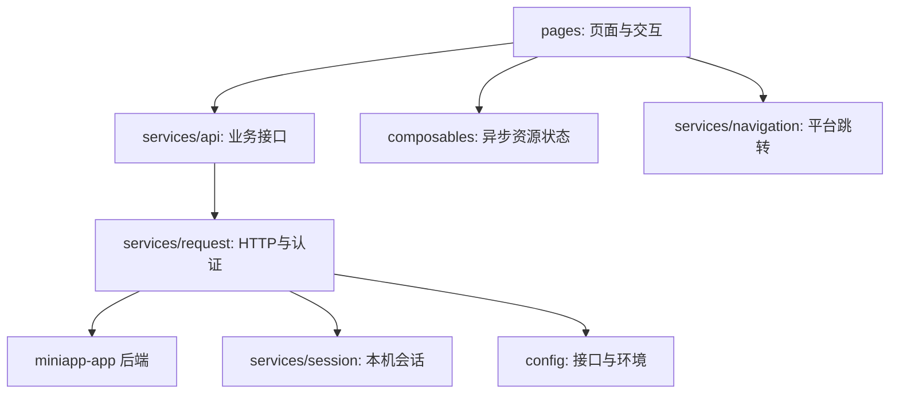

# 前端架构与检查记录

检查日期：2026-11-17（Asia/Shanghai）。

当前项目是独立的 uni-app Vue 3 + Vite 前端。页面、业务接口、请求与会话处理已分开，适合目前领券、个人订单、个人中心三个页面的规模。

## 本次修正

- 公共接口与受保护接口显式区分，公共请求不携带 token。
- 会话校验包含有效期和必要字段，过期或损坏的数据自动清除。
- 旧401不能清除新登录，退出后完成的旧请求不会返回个人数据给页面。
- 切换服务器后，原服务器的异步响应失效。
- 页面共享 useAsyncResource，刷新只接受最新一次结果，退出或卸载会使旧请求失效。
- 生产构建忽略本地开发接口覆盖，开发体验登录与连接设置始终隐藏。
- 开发地址允许清空以恢复默认代理或本机地址。
- H5 点击跳转时先提示使用微信端，不创建无法实际跳转的推广记录。
- 开发者工具根配置、依赖、编译产物、缓存和本地环境文件不提交。

## 验证

| 检查 | 结果 |
| --- | --- |
| Node 自动化测试 | 23项通过，覆盖请求、会话、环境切换、异步竞态、平台跳转及金额展示 |
| 微信小程序生产编译 | 通过，产物位于 dist/build/mp-weixin |
| H5 生产编译 | 通过，产物位于 dist/build/h5 |

测试与编译使用本机 Node 24.22.3。依赖版本由 package-lock.json 固定。本轮未升级依赖。

微信 AppID 和真实联盟接口尚未提供，因此没有声称完成真实微信登录、平台领券跳转和订单回传验证。生产使用前须配置真实微信 AppID、HTTPS API 和对应合法域名。

本地编译日志在忽略目录 `.cache/review-build-weixin.log` 与 `.cache/review-build-h5.log`。
