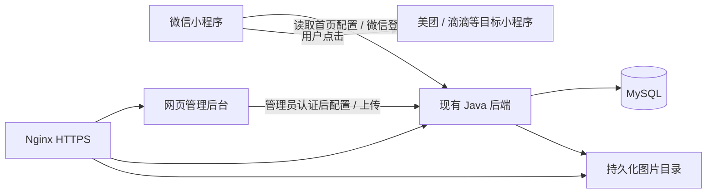

# 可配置生活服务入口小程序：第一版上线方案

日期：2026-11-17。

## 1. 建议方案

做一个“后台可配置的生活服务入口小程序”：前台用固定组件展示轮播图、图标宫格和活动卡片；用户点击后打开美团、滴滴等目标微信小程序；运营人员通过电脑后台维护图片、文字、跳转目标、顺序和上下架。

继续使用现有 uni-app 前端和 Java 后端，增加一个轻量网页管理后台。第一版采用单体部署，不增加微服务、Redis、消息队列和可视化拖拽装修系统。

这版验收目标是：**管理员在后台新增一个真实入口，上传图标并保存，小程序重新进入首页后展示入口，用户点击可以打开对应小程序。**

## 2. 现有项目可以复用什么

本方案基于代码检查，尚未做真实微信账号和生产环境联调。

| 项目 | 当前状态 | 第一版处理 |
| --- | --- | --- |
| `miniapp-web` | uni-app + Vue 3 + Vite，已有首页、订单、个人中心 | 首页改成模块化入口，个人中心保留微信登录 |
| 前端请求与会话 | 已有请求封装、Token 存储、过期处理 | 继续复用 |
| 小程序跳转 | 已有 `uni.navigateToMiniProgram` 封装 | 改为读取后台配置；修正当前强制要求 path 的校验 |
| `miniapp-app` | JDK 21、Spring Boot，现有六模块结构 | 沿现有结构增加配置管理和管理员认证 |
| 微信登录 | 已有 code 换 openid、用户创建、随机 Token 会话 | 配置真实 AppID / AppSecret 后联调，不重复开发 |
| 数据库 | 默认 H2，已有 MySQL 配置和用户、会话表 | 本地继续现状，正式环境使用 MySQL |
| 联盟推广 | 当前适配器为占位实现，推广接口返回未接入 | 配置好的固定入口直接跳转，不依赖这个接口 |
| 配置后台和图片上传 | 当前业务源码中未发现相应功能 | 本次新增 |

当前代码不是“配置地址即可上线”的完整产品，主要缺口是入口配置、管理页面、管理员鉴权和图片上传。

## 3. 第一版功能范围

### 小程序端

| 页面 / 能力 | 第一版内容 |
| --- | --- |
| 首页 | 轮播图、图标宫格、活动卡片；按后台配置展示模块和入口 |
| 图标入口 | 图片、名称；点击打开对应小程序 |
| 活动卡片 | 图片、标题、简短说明；点击打开对应小程序 |
| 我的 | 微信登录、登录状态、退出本机登录、隐私说明入口 |
| 基础体验 | 加载、空状态、失败重试、图片加载失败占位、跳转取消与失败反馈 |

普通浏览和固定链接跳转允许游客使用。微信登录用于识别本站用户，第一版不要求用户先登录才能点击图标。微信登录也不会让用户自动登录美团、滴滴等其他平台。

现有订单页面先从第一版底部导航移除，代码保留。普通跳转不会产生本站订单，也无法自动获取第三方平台订单。

### 网页管理后台

后台使用电脑浏览器访问，地址建议为 `https://业务域名/admin/`。

| 功能 | 管理内容 |
| --- | --- |
| 管理员登录 | 独立账号密码、退出、会话过期处理；第一版一个管理员角色 |
| 模块管理 | 模块名称、展示类型、顺序、启用 / 停用 |
| 入口管理 | 所属模块、名称、说明、图标 / 图片、AppID、页面路径、排序、上下架 |
| 图片上传 | 上传、预览、获取图片地址、替换图片 |
| 保存校验 | 必填项、图片格式、跳转参数格式校验；保存前展示配置摘要 |

第一版采用“保存后生效”，不增加草稿、审批流、定时发布和历史版本系统。一个入口的字段在同一事务内保存，避免保存了一半。

运营示例：

1. 创建“出行服务”模块，选择图标宫格。
2. 新增“滴滴打车”入口，上传图标。
3. 填写经过真机验证的目标 AppID 和 path，设置排序并启用。
4. 保存后，用户重新进入首页或下拉刷新，就能看到该入口。

文字、图片、链接和顺序属于配置修改，不需要重新编译小程序；新增组件类型、修改页面结构或增加原生能力，仍然需要修改代码并按平台流程发布。配置内容仍须符合平台要求。

## 4. 跳转方案：需要先验证的关键点

### 4.1 小程序地址和普通网址分开处理

第一版正式支持 `MINIPROGRAM` 跳转，以 **AppID + path** 为标准配置。AppID 必填；path 可以为空，表示打开目标小程序首页；要直达活动页则填写真实页面路径及其参数。这个行为见 [uni-app 官方跳转文档](https://uniapp.dcloud.net.cn/api/other/open-miniprogram.html)。

例如，后台填写的是下面这种结构，而不是随意粘贴一个网页地址：

```json
{
  "title": "出行入口",
  "imageUrl": "https://你的业务域名/media/唯一文件名.png",
  "targetType": "MINIPROGRAM",
  "appId": "目标平台提供的真实AppID",
  "path": "目标平台提供的真实页面路径及参数",
  "extraData": {},
  "enabled": true,
  "sortOrder": 10
}
```

上面是结构示意，不是可直接使用的美团或滴滴地址。不要猜测这些平台的 AppID、页面路径或联盟参数。

如果目前拿到的只有 `https://...` 网页链接、`#小程序://...` 分享链接、短链或二维码，应先拿一个真实样例验证对应的接入方式。第一版不承诺任意类型的链接都能直接使用；网页跳转和分享短链支持按实际样例再决定是否增加。

### 4.2 点击时直接使用已加载的目标

首页接口一次返回展示信息和可公开的跳转参数，用户点击入口后调用小程序跳转接口。前端不再先调用当前尚未接入的联盟推广接口。

跳转由用户点击触发，不在页面加载时自动打开第三方小程序。若后续需要统计点击，统计请求异步执行，不阻塞跳转。用户取消跳转正常结束操作，真实失败再提示重试。

上线前必须在 Android 和 iPhone 微信真机上验证实际跳转及返回流程。H5 预览不能作为微信小程序跳转验收依据；uni-app 官方平台支持表中该接口也不支持 H5。

### 4.3 固定入口和返佣业务分开验收

已有可用的普通入口或固定推广目标时，可以先手工维护并完成本版。平台品牌图片和活动素材使用有权使用的素材。

如果业务目标还包含“每个用户下单归属、返佣、提现或查平台订单”，需要另行接入平台联盟或服务商接口，确认推广参数、回调和订单同步。仅有固定跳转链接无法完成这些能力。

## 5. 技术实现

### 5.1 结构与部署关系



- 小程序继续在 `miniapp-web/src` 开发。
- 网页管理端建议放在前端仓库的 `admin-web/`，使用 Vue 3，单独构建为静态文件，由 Nginx 提供访问。
- 后端继续放在 `D:\IDEA work\miniapp-app`，沿用 `api / app / domain / infrastructure / trigger / types`，不新增部署服务。
- 配置相关 DTO 放 `api`，服务和仓储接口放 `domain`，数据库与文件实现放 `infrastructure`，管理和公开接口放 `trigger`，环境和建表脚本放 `app`。

### 5.2 最小数据设计

| 表 | 用途与主要字段 |
| --- | --- |
| `app_member`、`member_session` | 复用现有微信用户和用户会话 |
| `nav_module` | id、标题、布局类型 BANNER / GRID / CARD、排序、启用状态 |
| `nav_entry` | id、module_id、名称、说明、image_url、target_type、app_id、path、extra_data_json、排序、启用状态、修改时间 |
| `admin_account` | 管理账号、密码哈希、启用状态 |
| `admin_session` | 管理会话 Token 哈希、管理员 id、过期时间 |

装饰性图片可使用 `NONE` 目标类型，展示但不跳转。第一版只接收允许的布局类型和跳转类型，不允许后台配置可执行脚本。

公开接口只返回启用模块中的启用入口；管理员密码、管理会话和后端密钥不进入公开响应。小程序用户 Token 不能调用管理接口。

### 5.3 接口规划

继续使用现有统一响应结构 `{ code, message, data }`。

| 接口 | 权限 | 用途 |
| --- | --- | --- |
| `GET /api/v1/home` | 公开 | 一次返回按顺序组织的模块及入口 |
| `POST /api/v1/auth/wechat-login` | 公开 | 复用现有微信登录 |
| `GET /api/v1/users/me` | 用户会话 | 复用现有当前用户接口 |
| `POST /api/v1/admin/auth/login` | 公开，限制尝试频率 | 管理员登录 |
| `POST /api/v1/admin/auth/logout` | 管理会话 | 服务端注销管理会话 |
| `/api/v1/admin/modules`、`/api/v1/admin/modules/{id}` | 管理会话 | GET / POST / PUT / DELETE 管理模块 |
| `/api/v1/admin/entries`、`/api/v1/admin/entries/{id}` | 管理会话 | GET / POST / PUT / DELETE 管理入口 |
| `POST /api/v1/admin/files` | 管理会话 | 上传图片并返回 HTTPS 地址 |

首页在进入、重新显示和下拉刷新时获取配置。第一版不做 Redis 和长时间配置缓存；已经打开的页面不会被后台修改即时推送更新，重新请求后生效。

### 5.4 微信登录

沿用现有实现：`uni.login` 获取 code → 后端调用微信 `jscode2session` → 按 openid 查询或创建用户 → 返回本站 Token。

现有代码已使用随机 Token、数据库保存 Token 摘要和过期时间，可直接复用。不需要为了本版另换 JWT。AppSecret 只放后端环境变量，不能进入小程序包、首页配置或管理页面响应；如处理 session_key，也只能留在服务端。

第一版只做用户身份识别，不采集手机号、微信头像和昵称。后续确有业务需要再单独设计相应交互。

### 5.5 图片与后台基础保护

为减少首次部署步骤，图片先存服务器独立持久化目录，通过 Nginx 以 HTTPS 提供访问。目录不能放在构建产物和临时目录中，重启或重新部署后仍保留。后续需要多实例或更多图片时再换对象存储。

上传仅允许 PNG / JPEG / WebP，建议单张不超过 2MB；服务端检查真实图片格式，随机命名，不接受用户指定磁盘路径。更换图片生成新地址，避免旧缓存影响展示。

管理员密码使用成熟密码哈希算法，初始化密码通过部署配置提供，不在源码里写死。管理会话与普通用户会话分离，提供过期和退出失效机制。数据库和图片目录做定时备份并验证能恢复。

## 6. 上线方式和前置条件

第一版建议：**一台服务器 + Nginx HTTPS + 一个 Java 后端进程 + MySQL + 持久化图片目录**。管理后台是静态页面，不需要另外运行 Node 服务。

Nginx 分别提供 `/admin/` 管理页面、`/api/` 后端接口、`/media/` 图片。数据库不直接对公网开放，后端使用生产配置，不启用开发体验登录。

开始完整开发前，优先完成两个验证：

1. 用一个真实美团或滴滴入口，在现有小程序工程中验证能够正常跳转。
2. 在微信公众平台核对账号主体、服务类目、当前跳转和内容要求，确认这种以服务入口为主的产品适合提审。开发完成不等于保证审核通过。

需要准备的资料：

- 自己的微信小程序账号和 AppID，后端通过安全配置读取 AppSecret。
- 首批入口名称、图标 / 图片、目标 AppID、页面路径及参数，特别注明是否为推广链接。
- 服务器、可用的 HTTPS API 域名，以及微信后台要求的域名配置；域名和小程序备案要求以主管平台和当前账号后台为准。
- 小程序名称、简介、类目、隐私保护说明等提审资料。

如果已有这些资源，优先复用。服务器采购、备案、账号资质处理和微信审核不计入代码开发时间，也不承诺固定完成日期。

## 7. 建议开发顺序与验收

按现有代码基础、首批地址和素材齐备、一个开发人员投入估算，约 **3–5 个开发工作日达到可提审版本**，这是计划估算，真实跳转受限或资料缺失时需要调整。

| 顺序 | 交付内容 |
| --- | --- |
| 1 | 真实入口跳转验证，确认模块字段、首批配置和账号前置条件 |
| 2 | 后端配置表、公开首页接口、管理鉴权和管理接口 |
| 3 | 网页后台模块 / 入口管理、图片上传和配置校验 |
| 4 | 小程序轮播 / 宫格 / 卡片、游客跳转、微信登录联调 |
| 5 | 真机验收、生产部署、备份验证、整理提审材料 |

上线验收至少覆盖：

- 管理员新增、修改、排序和停用模块及入口，首页刷新后与配置一致。
- 图片上传成功，非法文件被拒绝，应用重启和重新部署后图片仍可用。
- 游客可以浏览及跳转；真实微信登录成功，过期会话能够重新登录。
- 普通用户、未登录请求和过期管理会话不能修改配置或上传图片。
- 每个首发入口在 Android 和 iPhone 微信上实测；路径为空时打开目标首页，活动路径打开对应活动。
- 用户取消跳转、平台不可用、网络失败均有合理处理；没有虚构订单或返佣信息。
- 生产使用 HTTPS 和真实合法域名配置，开发登录不可访问，备份能够恢复。

## 8. 本版之后再考虑

点击统计、用户收藏、搜索、多管理员权限、拖拽装修、定时上下架、历史配置回滚、对象存储、联盟动态推广链接和订单回传，按实际运营需求分批增加。

**第一版的工作重点是把“配置入口 → 首页展示 → 真实跳转”做完整，同时复用已有微信登录。** 本文仅为实施方案，尚未修改业务代码或部署服务。
